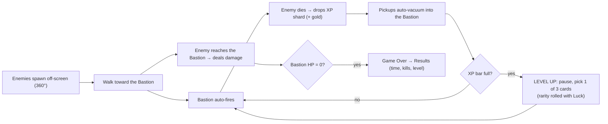

# 01: Game Design Document

## 1. Elevator pitch
A pixel-art **roguelike tower defense** for phones. One magical tower stands in the middle of the screen. Endless hordes pour in from beyond the screen edges, from every direction, trying to smash it. The tower fires automatically. **You build it.** Each level-up offers a pick of weapons and tomes with rolled rarity, and the build snowballs until you're the bullet-heaven and they're the ones being rained on.

Inspired by **Megabonk** (level-up drafting, tomes, rarity multipliers, the luck/curse economy). Megabonk's 3D movement is swapped for a single stationary bastion.

## 2. Design pillars
1. **Build-crafting power fantasy.** Every level-up is a meaningful choice. Synergies should feel exponential.
2. **Readable chaos.** Hundreds of enemies, but threats and rarity are always readable at a glance in pixel art.
3. **One-thumb mobile.** Portrait, short sessions, all decisions made with taps. Nothing needs precise aim.
4. **Incremental.** Each milestone produces something playable. Systems are data-driven so content is cheap to add.

## 3. Platform & presentation
| Item | Decision |
|---|---|
| Platforms | Android / iOS (primary), Web (testing + secondary) |
| Orientation | **Portrait**, locked |
| Virtual resolution | **180 × 320** pixel canvas, integer-scaled, letterboxed |
| Art | Pixel art. Placeholder shapes until assets exist |
| Engine | Flutter + Flame |

## 4. Core loop

## 5. Player agency (v1)
- **Combat is fully automatic.** Weapons auto-target enemies heading for the tower.
- The player's decisions are:
  - **Level-up drafting** (pick 1 of 3, plus Reroll / Skip / Banish in a later milestone)
  - Which **4 weapons** and **4 tomes** fill the slots
  - Pause / quit
- Phase 2 adds the **Warden** (a controllable cursor/drone), active skills, and interactables. See [3.11](03_systems/3.11_phase2_interactables.md).

## 6. Megabonk → BONKHOLD translation

| Megabonk | BONKHOLD v1 | Later phase |
|---|---|---|
| Character | **Core Factor / tower** (starting weapon + per-level passive) | More towers, side-turret towers |
| Movement / dodging | Removed. Evasion becomes a passive **Deflect** stat | Warden drone |
| XP gems | XP shards, **auto-vacuumed** to the tower | — |
| Gold | Gold coins, auto-vacuumed, **stored only** in v1 | Chests, shop, Microwave |
| Weapons (4 slots) | Same: 4 weapon slots, local upgrades | — |
| Tomes (4 slots) | Same: 4 tome slots, global stats | — |
| Items | — | Phase 2 |
| Rarity Factor | Same: Common 1.0× → Legendary 2.0× | — |
| Shrines / Chests / Microwave | — | Phase 2 |
| Stage timer + Final Swarm | **Endless mode** with escalating difficulty and an "Overtime" surge | Story mode with fixed stages |
| Silver / quests | — | Meta progression |

## 7. Scope

### In v1 (prototype)
- 1 tower: **Kitsune Spire** (Fox-style, Luck scaling, Ember Staff)
- 4 weapons, 8 tomes, rarity rolls
- 4 enemy types + elites + a periodic boss
- XP and gold auto-vacuum, level-up draft
- Endless mode, game over, results screen
- HUD, pause, debug overlay

### Out of v1 (documented, on hold)
- Items, chests, shrines, Microwave, merchants
- Warden / manual control, active skills
- Meta progression (silver, unlocks, quests)
- Additional tower types, side-mounted hardpoints
- Story mode with fixed stage lengths

## 8. Win / lose (endless)
- **Lose:** Bastion HP reaches 0.
- **No win state.** Score = survival time (primary), kills, and level reached.
- After 15:00, **Overtime** begins (a Megabonk Final Swarm analogue). Difficulty ramps sharply.

## 9. Tone & theme (proposal)
Japanese folklore with a cheeky edge. A fox-spirit shrine tower holds off waves of goofy yokai and critters. Bright, saturated palette on dark grounds so projectiles read clearly.
