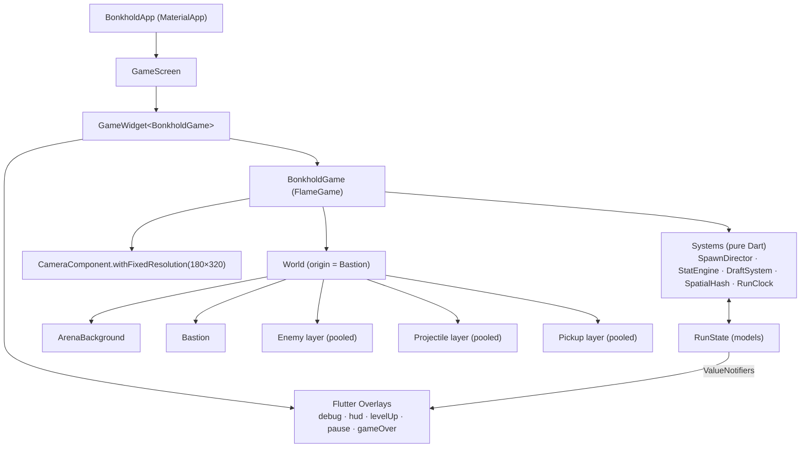

# 02: Tech Architecture

## 1. Stack
| Layer | Choice | Version (at setup) |
|---|---|---|
| Framework | Flutter (stable) | 3.47.5 / Dart 3.13.4 |
| Game engine | Flame | 1.38.2 |
| Testing | flutter_test, flame_test | flame_test 2.3.1 |
| Audio (M6+) | flame_audio | TBD |
| Platforms | Android, iOS, Web | — |

## 2. High-level structure



**Golden rule:** *Components render and move. Systems decide.* Game rules (damage math, draft odds, stat stacking, spawn budgets) live in plain Dart classes under `lib/systems/` and `lib/models/`. That keeps them unit-testable without Flame.

## 3. Folder layout

```
lib/
  main.dart                  App entry, portrait lock, GameWidget + overlay map
  config/game_config.dart    Virtual resolution, palette, global constants
  game/
    bonkhold_game.dart       FlameGame root: camera, world, system wiring
    components/              Flame components (Bastion, Enemy, Projectile, Pickup, VFX)
  systems/                   Pure-Dart rules: spawn_director, stat_engine, draft_system,
                             damage_resolver, spatial_hash, run_clock
  data/                      Content registries: weapons, tomes, enemies, characters, (items: Phase 2)
  models/                    StatSheet, RunState, Rarity, UpgradeRoll, defs
  ui/
    overlays/                Flutter overlays (HUD, LevelUp, Pause, GameOver, Debug)
    widgets/                 Reusable pixel-styled widgets (PixelButton, RarityCard)
  util/                      Pool<T>, seeded Rng, math helpers
assets/
  images/                    Sprite sheets (see 05_ART_PIXEL_ASSET_LIST.md)
  audio/                     SFX + music (see 06_AUDIO_ASSET_LIST.md)
test/                        Unit tests (systems) + flame_test (components)
docs/                        This documentation
```

## 4. Coordinates, camera & pixel art
- **World origin (0,0) = Bastion center.** Up is -Y (Flame default).
- `CameraComponent.withFixedResolution(width: 180, height: 320)` with the viewfinder anchored at the center. The viewport scales to fit and letterboxes. Black bars on wide web windows are expected.
- **Pixel crispness:**
  - Sprites are loaded with `FilterQuality.none` (`Paint()..filterQuality = FilterQuality.none`).
  - Positions are rendered snapped to whole pixels (`position.x.roundToDouble()`) for static/slow objects. Fast projectiles may sub-pixel.
  - *M0 follow-up:* evaluate **integer-only scaling** (custom `Viewport` that picks `floor(screen/virtual)`) to avoid uneven pixels. The fixed-resolution viewport can scale by non-integers.
- **Visible half-extents:** 90 × 160. Enemies spawn on a ring of radius `GameConfig.spawnRadius = 200` (just beyond the half-diagonal ≈ 184).

## 5. Game loop & update order
Flame calls `update(dt)` on the component tree. To keep order deterministic, `BonkholdGame.update` drives systems explicitly:

```dart
@override
void update(double dt) {
  if (runState.isPaused) return;          // level-up / pause freezes the sim
  final step = dt.clamp(0, 1 / 20);       // avoid huge steps after tab-switch
  runClock.tick(step);
  spawnDirector.update(step);             // 1. spawn
  super.update(step);                     // 2. components move (enemies, projectiles)
  spatialHash.rebuild(enemies.active);    // 3. broadphase
  combatSystem.update(step);              // 4. targeting, firing, hits, deaths
  pickupSystem.update(step);              // 5. vacuum + collect
}
```

Pausing: set `runState.isPaused` (or `pauseEngine()` for full freeze) while the **LevelUp** overlay is open.

## 6. Performance strategy (mobile-first)
Target: **60 FPS on a mid-range Android** with **400 enemies + 300 projectiles + 200 pickups**.

| Technique | Detail |
|---|---|
| **No Flame collision callbacks** for enemies/projectiles | `HasCollisionDetection` is fine for a handful of objects, not hundreds. Use our own `SpatialHash` |
| **SpatialHash** | Uniform grid (cell 32 px). Rebuilt each frame. Queries: `nearest(pos)`, `inRadius(pos, r)` |
| **Object pooling** | `Pool<Enemy>`, `Pool<Projectile>`, `Pool<Pickup>`, `Pool<DamageNumber>`. Components stay mounted and toggle `isActive`, or are removed/re-added from the pool. Never `new` on hot paths |
| **Circle-only collisions** | Every entity has a `radius`. Hit test = squared distance |
| **Entity caps** | Max live enemies (e.g. 500). XP shards **merge** into higher tiers when the count exceeds a cap |
| **Batch rendering** | Once sprites exist, use `SpriteBatch` / a single atlas per layer |
| **Avoid allocations** | Reuse `Vector2` temporaries. No closures or lists created per frame in systems |
| **Overlays refresh sparingly** | HUD listens to `ValueNotifier`s that change on events, not every frame |

## 7. State management
- `RunState`: a plain Dart object holding level, xp, gold, time, kills, owned weapons/tomes, and the RNG seed.
- `StatSheet`: final computed stats (recomputed only when something changes, see [3.1](03_systems/3.1_stats_and_formulas.md)).
- UI reads `ValueNotifier<T>` fields exposed by `RunState` (e.g. `hp`, `xpProgress`, `level`, `gold`, `elapsed`).
- **No external state library** in v1. Revisit if meta progression or menus grow (Riverpod is a candidate).

## 8. Content definitions
- Content (weapons, tomes, enemies, characters) is **Dart `const` registries** in `lib/data/`. See [08_DATA_SCHEMAS.md](08_DATA_SCHEMAS.md).
- Why Dart over JSON for now: type safety, autocomplete, hot reload, and no parsing code. The schema is documented so we can move to JSON later (modding, remote balance).

## 9. Randomness
- One `Rng` per run, seeded from the clock (or fixed in debug). **All** gameplay randomness goes through it (spawns, draft, rarity, crits).
- Benefits: reproducible bugs, future "daily seed" mode.

## 10. Overlays (Flutter UI over the game)
| Id | When | Notes |
|---|---|---|
| `debug` | Debug builds | FPS, entity counts, cheats |
| `hud` | During a run | HP/shield, XP bar, timer, level, kills, gold, slots |
| `levelUp` | On level-up | Pauses the sim. 3 cards |
| `pause` | Pause button / app backgrounded | Resume / Quit |
| `gameOver` | HP = 0 | Results + Retry |

Overlay ids live in `lib/ui/overlays/overlay_ids.dart`.

## 11. Platform notes
- **Web (dev loop):** `flutter run -d chrome`. Hot reload works. Use Chrome DevTools device toolbar (e.g. 390×844) to preview portrait.
- **Android/iOS:** `flutter run` with a device attached. Orientation is locked to portrait in `main()`. Also set it in the native configs before release (`android:screenOrientation="portrait"`, iOS `UISupportedInterfaceOrientations`).
- **Lifecycle:** auto-pause when the app goes to the background (`AppLifecycleListener`). Planned for M1.
- **Safe areas:** HUD overlays wrap with `SafeArea`. The game canvas itself is letterboxed, so notches only affect overlays.

## 12. Debug tooling (grows per milestone)
- FPS (M0 ✅)
- Entity counts per pool (M2)
- God mode, +1 level, spawn boss, time ×4, show hitboxes/spatial grid (M2–M3)
