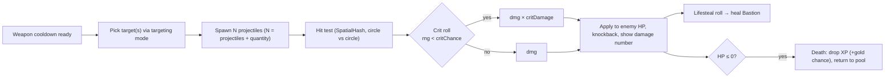
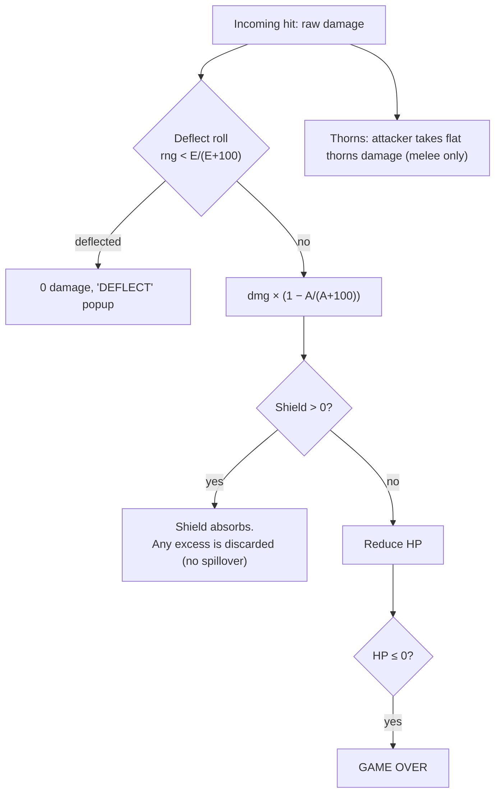

# 3.2: Combat & Damage Pipeline

## Purpose
Defines how damage flows **from weapons to enemies** (outgoing) and **from enemies to the Bastion** (incoming).

---

## A. Outgoing (weapon → enemy)

### Rules
- **Damage per hit** = `weapon.damage × stats.damage × (crit ? stats.critDamage : 1)`.
- **Pierce:** a projectile can hit `pierce + 1` distinct enemies before despawning. It tracks already-hit enemy ids so it never double-hits.
- **Bounces** (later weapons): after a hit, retarget the nearest un-hit enemy within 40 px.
- **AoE explosions** (Ember Staff): on first contact, deal damage to every enemy within `radius`. Crit is rolled **once per explosion**.
- **Auras:** tick every `cooldown`. Every enemy in the radius takes the tick.
- **Knockback:** push the enemy away from the Bastion by `knockback × (1 - enemy.knockbackResist)` px over 0.1 s.
- **Damage numbers:** pooled pixel text. Crits shown larger and colored. Disable-able in settings for performance.

### Targeting modes
| Mode | Picks | Used by |
|---|---|---|
| `closestToBastion` | Enemy with the smallest distance to (0,0), i.e. the biggest threat | Ember Staff, Revolver (default) |
| `highestMaxHp` | Tankiest enemy in range | Rail Sniper |
| `densest` | Center of the biggest cluster (sample the SpatialHash cells) | Future AoE weapons |
| `random` | Random enemy in range | Fallback, some procs |

Only enemies **inside the weapon's range** and **visible on screen (with a 16 px margin)** can be targeted, so the tower doesn't waste shots off-screen.

---

## B. Incoming (enemy → Bastion)

Enemies that reach the Bastion **stop and attack** every `attackInterval` (default 1.0 s) for `contactDamage`. They do **not** die on contact, so they keep pressuring the tower until killed. Spitters hit from range with projectiles.

### Rules
- **Minimum damage** after armor: 1 (unless deflected).
- **Shield** recharges to full after **5 s** with no damage taken. Recharge is instant in v1 (a quick fill animation can come later).
- **Regen:** `hp += hpRegen × dt`, capped at maxHp.
- **Lifesteal:** on each weapon hit, `if rng < lifesteal % 1 → heal 1`, plus `floor(lifesteal)` guaranteed heals. Capped at maxHp.
- **Overheal** (excess healing becomes a decaying buffer): **Phase 2**.
- **i-frames:** none. Armor and Deflect do the job instead. A 0.1 s hit-flash is visual only.

## Acceptance criteria
- [ ] `DamageResolver` (pure Dart) unit tested: deflect, armor reduction, shield no-spillover, min damage, thorns
- [ ] Projectiles never hit the same enemy twice
- [ ] Enemies at the Bastion attack on an interval, not every frame
- [ ] Game Over triggers exactly once
