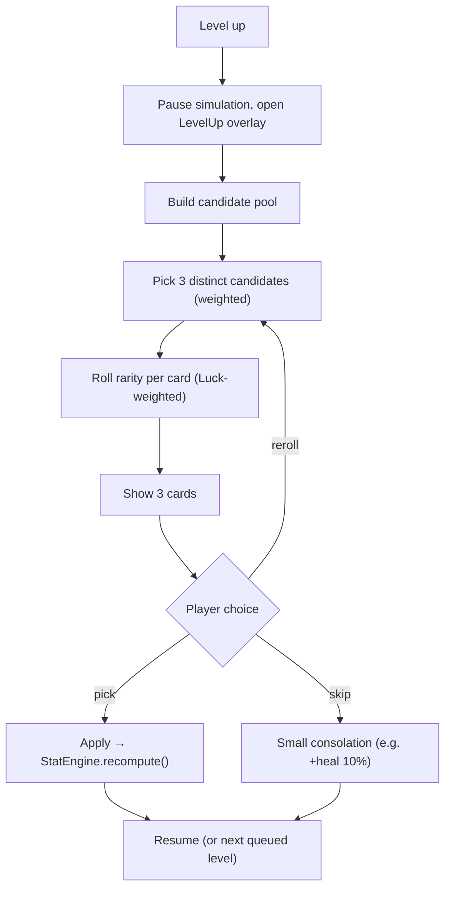

# 3.3: Progression, Level-Up & Rarity

## Purpose
How XP turns into levels, and how the 1-of-3 level-up draft works, including rarity rolls.

## XP curve
```
xpToNext(L) = round(5 + 4·(L−1) + 0.6·(L−1)²)
```
| Level | 1 | 2 | 5 | 10 | 20 | 30 |
|---|---|---|---|---|---|---|
| XP needed | 5 | 10 | 31 | 90 | 297 | 627 |

- Collected XP = `shard.value × (1 + stats.xpGain)`.
- Overflow XP carries over. Multiple level-ups queue, and the draft shows once per queued level.
- On level-up: the character passive applies (Kitsune: +1.5% Luck), then the draft opens.

## The draft



### Candidate pool
| Card type | Available when | Effect |
|---|---|---|
| **New Weapon** | A weapon slot is free (max 4) | Add weapon at level 1. **No rarity** (always base stats) |
| **Weapon Upgrade** | Weapon owned | 1–2 random stats from that weapon's upgrade pool, each `increment × rarityMult` |
| **New Tome** | A tome slot is free (max 4) | Add tome at level 1 with `increment × rarityMult` |
| **Tome Upgrade** | Tome owned | `increment × rarityMult` added |
| **Fallback** | Pool empty | "+25% HP heal" or "+10 gold" |

Weighting: owned-item upgrades get weight **2**, new items weight **1**, so builds get deeper rather than only wider. Candidates in one draft are distinct (no two cards for the same weapon/tome).

### Rarity
| Rarity | Color | Multiplier | Base weight |
|---|---|---|---|
| Common | Gray/White | 1.0× | 60 |
| Uncommon | Green | 1.2× | 25 |
| Rare | Blue | 1.4× | 10 |
| Epic | Purple | 1.6× | 4 |
| Legendary | Gold | 2.0× | 1 |

**Luck formula:** `weight(tier) = baseWeight(tier) × (1 + luck)^tierIndex` (Common=0 … Legendary=4).
With Kitsune's starting 15% Luck: Legendary weight = 1 × 1.15⁴ ≈ 1.75 (≈ 1.7% chance). At 100% Luck: 16 (≈ 9%).

**Integer stats** (projectiles, pierce, quantity) use `round(increment × rarityMult)`, minimum 1.

### Reroll / Skip / Banish (M4+)
| Action | Charges per run (v1) | Effect |
|---|---|---|
| Reroll | 2 | Redraw all 3 cards |
| Skip | 2 | Take the fallback instead |
| Banish | 1 | Remove a weapon/tome from the pool for this run |

## Acceptance criteria
- [ ] `DraftSystem` unit tests: slot limits respected, distinct cards, fallback when empty
- [ ] Rarity distribution test over 100k rolls matches the formula within ±1%
- [ ] Queued level-ups each show a draft
- [ ] Simulation is fully paused while the overlay is open
