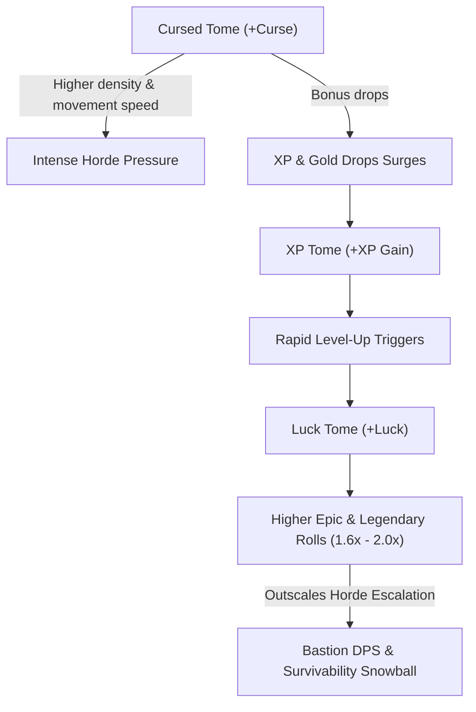

# 3.5: Tomes Specification

## Purpose
Specifies global stat tomes that modify the entire Bastion matrix across all weapons, defense layers, and economy systems.

---

## 1. Core Tome Rules
- **Slot Limit:** Maximum **4 active tomes** equipped per run.
- **Global Cascade:** Tome increments apply globally to all weapons and core calculations via `StatEngine.recompute()`.
- **Leveling:** Each time a tome is selected upon level-up, its level increases by 1, and its stat bonus increases by `Increment × RarityFactor`.
- **Rarity Scaling:** Rarity multipliers follow the standard tiers:
  - Common: 1.0×
  - Uncommon: 1.2×
  - Rare: 1.4×
  - Epic: 1.6×
  - Legendary: 2.0×

---

## 2. Tome Roster (v1 Prototype - 8 Core Tomes)

| Tome Name | Global Stat Affected | Base Increment (Common 1.0×) | Max Level | Notes & Scaling Behavior |
|---|---|---|---|---|
| **Damage Tome** | `damage` | +8% (+0.08×) | 10 | Additive global damage multiplier on all weapons. |
| **Cooldown Tome** | `attackSpeed` | +7.5% | 10 | Reduces weapon attack cooldowns globally. |
| **Quantity Tome** | `quantity` | +1 Projectile | 5 | Adds extra projectiles per volley across all projectile weapons. |
| **Size Tome** | `size` | +10% | 10 | Expands blast radius (Ember Staff), Pulse Aura radius, and hitbox scales. |
| **Armor Tome** | `armor` | +12 Armor Points | 10 | Hyperbolic mitigation: enhances damage reduction curve $A / (A + 100)$. |
| **Luck Tome** | `luck` | +8% Luck | 10 | Skews card rarity rolls toward Epic & Legendary; synergizes with Kitsune passive. |
| **XP Tome** | `xpGain` | +10% XP Multiplier | 10 | Scales XP shard collection yield, accelerating level pacing. |
| **Cursed Tome** | `curse` | +5% Difficulty & Density | 10 | Increases enemy spawn density, speed, and yields +15% bonus gold/XP drops. |

---

## 3. High-Order Economy Loop: The "Holy Trinity"
The interaction between **XP Tome**, **Luck Tome**, and **Cursed Tome** forms the primary high-risk, high-reward economic engine adapted from Megabonk:

1. **Risk Injection:** Player drafts Cursed Tome, increasing wave speed and density.
2. **Resource Influx:** More enemies killed yielding boosted shard values.
3. **Draft Quality Acceleration:** Luck Tome drastically raises probability of rolling Epic (1.6×) and Legendary (2.0×) weapon and tome cards.
4. **Power Curve Escape Velocity:** Upgrades scale higher than the linear difficulty curve, creating a dominant power fantasy.

---

## 4. Acceptance Criteria
- [ ] Strictly capped at 4 equipped tomes per run.
- [ ] Equipping or upgrading a tome triggers `StatEngine.recompute()`.
- [ ] Quantity tome correctly adds discrete integer projectiles to projectile-based weapons.
- [ ] Tome upgrades display their rarity tier and exact rolled value on level-up cards.
