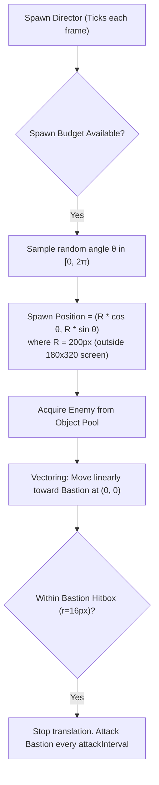

# 3.7: Enemies & Spawning Specification

## Purpose
Defines enemy behaviors, spatial movement vectors, spawn directors, difficulty budgets, and the initial roster of enemy archetypes.

---

## 1. Spawn Mechanics & Spatial Vectoring

- **Spawn Radius:** $R = 200\text{ px}$. The Bastion is anchored at $(0, 0)$. Since the camera view extents are $(-90, -160)$ to $(90, 160)$, $R=200$ guarantees enemies spawn off-screen from all 360° angles.
- **Pathing:** Linear vector toward $(0, 0)$. No complex obstacle pathfinding needed for the stationary arena, maximizing frame performance on mobile.

---

## 2. Spawn Director & Difficulty Scaling
The `SpawnDirector` maintains an internal **Spawn Credit Budget** that replenishes each second:

$$\text{CreditsPerSecond}(t) = \left(2 + 0.175 \times t + 0.0025 \times t^2\right) \times \left(1 + \text{Curse}\right)$$

Where $t$ is elapsed run time in seconds.
- Spawning occurs in bursts when accumulated credits meet or exceed an enemy type's cost.
- **Max Live Enemy Cap:** 400 active enemies on screen. Once reached, spawn director throttles until count decreases.

---

## 3. Enemy Roster (v1 Prototype)

| Archetype | Credit Cost | Base HP | Speed | Contact Dmg | Attack Cadence | Knockback Resist | Special Behavior / Notes |
|---|---|---|---|---|---|---|---|
| **Swarmling** | 1 | 18 | 48 px/s | 4 | 1.0s | 0% | Core fodder horde; relies on sheer numbers. |
| **Runner** | 2 | 24 | 72 px/s | 6 | 0.8s | 10% | High-velocity interceptor; tests point-defense reaction time. |
| **Brute** | 6 | 90 | 32 px/s | 18 | 1.5s | 65% | Armored ram; high knockback resistance; dangerous if reaching hull. |
| **Spitter** | 5 | 45 | 40 px/s | 8 (proj) | 2.0s | 25% | Halts at $110\text{ px}$ distance from tower; fires ranged projectile at core. |

### 3.1 Elite Modifiers
Any standard spawn has a $3\% \times (1 + \text{Curse})$ probability of spawning as an **Elite**:
- **Visuals:** $1.4\times$ sprite scale, distinct gold/purple outline or particle tint.
- **Stats:** $+200\%$ HP, $+30\%$ Damage, $+25\%$ Knockback Resistance.
- **Drop Guarantee:** Guarantees higher-tier XP shard and bonus Gold.

### 3.2 Stage Boss: Yokai Goliath (Periodic Spawn)
- **Spawn Interval:** Triggers every 3 minutes (180s) or at custom wave thresholds.
- **Base HP:** $1,500 + 175 \times (\text{WaveCount} - 1)$.
- **Speed:** $22\text{ px/s}$.
- **Abilities:**
  - *Seismic Slam:* Every 6 seconds, halts and launches an orbital shockwave.
  - *Minion Summon:* Spawns a ring of 8 Swarmlings around itself every 10 seconds.
- **Defeat Reward:** Clears active wave, drops massive gold cache and high-grade XP burst.

---

## 4. Acceptance Criteria
- [x] Enemies spawn exclusively outside the visible viewport ($R \ge 200\text{ px}$).
- [ ] Spitters correctly halt at ranged distance and fire projectiles towards $(0, 0)$ *(Milestone 5)*.
- [x] Enemies stop moving upon touching the Bastion collision radius and damage the tower on an interval.
- [x] Enemies are recycled / removed without memory leaks.
