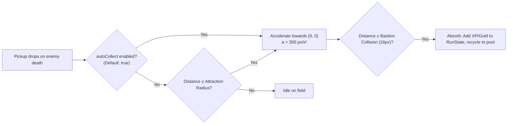

# 3.8: Economy: XP, Gold & Pickups

## Purpose
Specifies the in-run currencies, pickup dropping, gravitational vacuum automation, and performance-safe shard merging.

---

## 1. Pickup Currencies

### 1.1 XP Shards
Defeated enemies drop XP shards based on their tier:
| Shard Tier | Base Color | XP Value | Visual Appearance |
|---|---|---|---|
| **Lesser Shard** | Green | 1 XP | 4×4 pixel diamond |
| **Medium Shard** | Blue | 5 XP | 6×6 pixel gem |
| **Greater Shard** | Gold | 25 XP | 8×8 radiant gem |
| **Mega Shard** | Red/Crimson | 100 XP | 10×10 glowing crystal |

*Effective XP yield:* $\text{Granted XP} = \text{Shard Value} \times (1 + \text{stats.xpGain})$.

### 1.2 Gold Coins
- Enemies have a drop chance for Gold ($20\%$ for Swarmlings, $50\%$ for Brutes, $100\%$ for Elites and Bosses).
- In the v1 prototype, Gold is auto-collected and tracked in `RunState.gold` to validate balance and pacing.
- Spending gold (Chests, Shrines, Merchants) is scheduled for **Phase 2**.

---

## 2. Gravitational Auto-Vacuum Mechanics
Because the Bastion cannot physically walk to pick up loot, collection is automated via gravitational pull:

- **Global Auto-Collection (Default):** Because the Bastion is stationary and cannot traverse the field to collect drops, all standard XP shards and Gold coins default to `autoCollect = true` from any range across the map.
- **Attraction Radius Fallback:** Base `runState.stats.attraction` (48 px base) is preserved as a fallback query distance for non-autocollect items or deferred field interactables (e.g., Phase 2 chests/shrines).
- **Vacuum Physics:** Once attracted, pickups accelerate toward $(0, 0)$ at $350\text{ px/s}^2$ and are absorbed when entering the Bastion hull ($\le 16.0\text{ px}$).

---

## 3. High-Density Optimization: Shard Merging
When hundreds of enemies die in high-wave bursts, rendering hundreds of individual pickups will degrade mobile frame rates.
- **Pickup Cap:** 150 concurrent active pickups on field.
- **Merging Protocol:**
  - If total active pickups exceed 150, the `PickupSystem` groups adjacent low-tier shards (within 32 px of each other).
  - 5 Green Shards (1 XP each) compress into 1 Blue Shard (5 XP).
  - 5 Blue Shards compress into 1 Gold Shard (25 XP).
  - Visual effect: quick bright flash and merge sound/particle.

---

## 4. Chest Drops (Architectural Blueprint for Phase 2)
- **Drop Trigger:** Defeating Elites has a $25\%$ chance to drop a locked Chest; Stage Bosses have a $100\%$ guarantee.
- **Cost Scaling:** Chest opening costs Gold, scaling exponentially:
  $$\text{ChestCost}(n) = 25 \times 1.45^{(n - 1)}$$
  Where $n$ is the number of chests opened this run.
- **Phase 2 Status:** Implemented once Item Relics ([3.6](3.6_items.md)) and UI interaction systems are integrated.

---

## 5. Acceptance Criteria
- [x] Enemies drop XP shards with values proportional to their difficulty.
- [x] All dropables auto-vacuum toward the Bastion at (0, 0) from any range ($350\text{ px/s}^2$).
- [x] Shard merging prevents active pickups from exceeding 150 items *(Milestone 5)*.
- [x] Gold increments correctly in `RunState` and displays on HUD.
