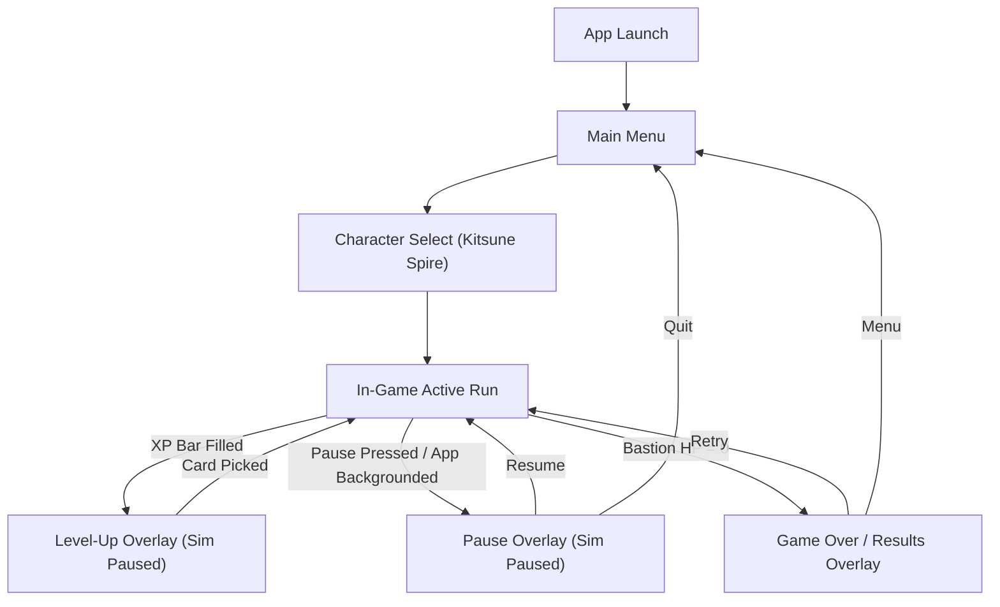

# 07: UI / UX & Screen Wireframes

## Purpose
Specifies user interface hierarchy, HUD layout, interactive overlay anatomy, and mobile touch ergonomics.

---

## 1. Application Screen Flow



---

## 2. In-Game HUD Wireframe & Architecture (Portrait Orientation)

The HUD is built entirely in Flutter widgets layered over Flame via `GameWidget.overlayBuilderMap`.

### 2.1 Responsive Bounding Architecture
Flame overlays receive loose constraints (`0.0 <= w <= screenWidth, 0.0 <= h <= screenHeight`) from `GameWidget`. To prevent `Stack` collapse where `Positioned` children evaluate to 0 width, and to ensure consistent alignment with the $180 \times 320$ portrait virtual canvas on widescreen web displays:
- The root of `HudOverlay` wraps in `SizedBox.expand -> SafeArea -> Align(center) -> ConstrainedBox(maxWidth: 480) -> Stack(fit: StackFit.expand)`.
- All HUD subcomponents are positioned within this bounded coordinate space.

### 2.2 Wireframe Layout

```
+-------------------------------------------------------+
| [ || ]   TIME 04:32    KILLS 284    GOLD 145          | <- Top Status Bar
|                                                 (FPS) | <- Debug Overlay (top: 46, right: 8)
|=======================================================| <- Level Badge & XP Progress Bar
|                 [BOSS: YOKAI GOLIATH]                 | <- Boss Health Bar (reactive)
|                 [======= 85% =======]                 |
|                                                       |
|                  [  ARENA VIEWPORT  ]                 |
|                   Center: BASTION                     |
|                                                       |
| [HULL: 85/100]  [SHIELD: 25]                          | <- Hull Status Bar
| [W1: Lv3] [W2: Lv1] [W3: --] [W4: --] (Weapons)       | <- Equipment Tray (4 slots)
| [T1: Lv2] [T2: Lv2] [T3: Lv1] [T4: --] (Tomes)        | <- Equipment Tray (4 slots)
+-------------------------------------------------------+
```

### 2.3 Layer Breakdown
1. **Top Status Bar (`top: 8, left: 8, right: 8`):**
   - **Pause Button:** Accessible icon button with $\ge 48 \times 48\text{ dp}$ touch target.
   - **Run Timer:** Formatted `MM:SS` tracking `RunState.elapsedTime`.
   - **Kills Counter:** Skull icon with total enemy vanquish count.
   - **Gold Counter:** Coin icon with accumulated gold total.
2. **Level Badge & XP Progress Bar (`top: 48, left: 8, right: 8`):**
   - **Level Indicator:** Golden amber badge (`LV X`) showing current Bastion tier.
   - **XP Progress Bar:** Sized linear indicator (`#3B82F6` blue) tracking fractional progress toward next level (`RunState.xpProgress`).
3. **Boss Health Bar (`top: 76, left: 8, right: 8`):**
   - Centered `ConstrainedBox(maxWidth: 260)`.
   - Reactively mounted whenever `RunState.bossHealthRatio > 0`.
   - Displays boss name, magenta accent bar (`#C026D3`), and percentage/HP readout.
4. **Hull Status Bar (`bottom: 96, left: 8, right: 8`):**
   - **Bastion Health Bar:** Emerald green bar (`#22C55E`) reflecting `hp / maxHp`.
   - **Hull Text:** Digital readout (e.g. `HULL: 85/100`).
   - **Shield Integrity Badge:** Appears dynamically with cyan accent (`#38BDF8`) when `shield > 0` (e.g. `[SHIELD: 25]`).
5. **Equipment Trays (`bottom: 8, left: 8, right: 8`):**
   - Reactive to `RunState.loadoutVersion` notifier.
   - **Weapon Slots (`W1`-`W4`):** Orange badges showing weapon title & current level, or `--` placeholder for vacant slots.
   - **Tome Slots (`T1`-`T4`):** Purple badges showing tome title & current level, or `--` placeholder for vacant slots.
6. **Overtime Vignette (`Positioned.fill`):**
   - Reactive to `RunState.isOvertime`.
   - Renders a pulsing crimson warning vignette and border past the 15:00 mark.
7. **Debug Overlay (`top: 46, right: 8`):**
   - FPS counter positioned in top-right corner, ensuring clear clearance from pause and timer touch targets.

---

## 3. Level-Up Card Anatomy

When leveling up, the simulation pauses and the `LevelUp` overlay presents 3 selectable upgrade cards:

```
+------------------------------------+
|  [RARITY COLOR BORDER: EPIC 1.6x]  |
|                                    |
|   [ICON]    EMBER STAFF            |
|             Weapon Upgrade         |
|                                    |
|   • Damage: 14 -> 19 (+5.0)        |
|   • Blast Radius: 28px -> 35px     |
|                                    |
|             [LEVEL 3]              |
+------------------------------------+
```

### Card Elements
1. **Rarity Header:** Border and accent color dynamically mapped to Rarity Tier (Gray, Green, Blue, Purple, Gold).
2. **Item Icon & Title:** Name of the weapon or tome being acquired/upgraded.
3. **Stat Delta Preview:** Displays current stat $\rightarrow$ upgraded stat with green delta indicators.
4. **Action Trays:** Bottom row includes utility charges: `[Reroll (2)]`, `[Skip (2)]`, `[Banish (1)]`.

---

## 4. Mobile Ergonomics & Safe Areas
- **Minimum Touch Target:** All interactive buttons and cards maintain a touch target $\ge 48 \times 48\text{ dp}$.
- **Safe Area Insets:** Top HUD bar and bottom equipment racks observe device notches and home indicator bars via Flutter's `SafeArea`.
- **Haptic Feedback:** Light tactile haptics on card selection, rarity reveal, and game over.
