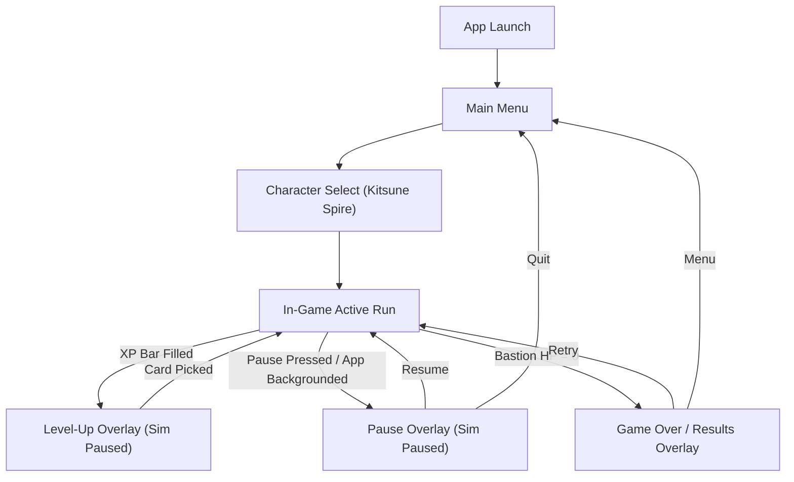

# 07: UI / UX & Screen Wireframes

## Purpose
Specifies user interface hierarchy, HUD layout, interactive overlay anatomy, and mobile touch ergonomics.

---

## 1. Application Screen Flow



---

## 2. In-Game HUD Wireframe (Portrait Orientation)

The HUD is built entirely in Flutter widgets layered over Flame via `GameWidget.overlayBuilderMap`:

```
+-------------------------------------------------------+
| [ || ]   TIME 04:32    KILLS 284    GOLD 145    (FPS) | <- Top Status Bar
|=======================================================| <- Full-width XP Bar
|                                                       |
|                                                       |
|                                                       |
|                  [  ARENA VIEWPORT  ]                 |
|                   Center: BASTION                     |
|                                                       |
|                                                       |
|                                                       |
| [HP: 85/100] [SHIELD: 25]                             | <- Hull Status Bar
| [W1: Lv3] [W2: Lv1] [W3: --] [W4: --] (Weapons)       | <- Equipment Tray
| [T1: Lv2] [T2: Lv2] [T3: Lv1] [T4: --] (Tomes)        | <- Equipment Tray
+-------------------------------------------------------+
```

---

## 3. Level-Up Card Anatomy

When leveling up, the simulation pauses and the `LevelUp` overlay presents 3 selectable upgrade cards:

```
+------------------------------------+
|  [RARITY COLOR BORDER: EPIC 1.6x]  |
|                                    |
|   [ICON]    EMBER STAFF            |
|             Weapon Upgrade         |
|                                    |
|   • Damage: 14 -> 19 (+5.0)        |
|   • Blast Radius: 28px -> 35px     |
|                                    |
|             [LEVEL 3]              |
+------------------------------------+
```

### Card Elements
1. **Rarity Header:** Border and accent color dynamically mapped to Rarity Tier (Gray, Green, Blue, Purple, Gold).
2. **Item Icon & Title:** Name of the weapon or tome being acquired/upgraded.
3. **Stat Delta Preview:** Displays current stat $\rightarrow$ upgraded stat with green delta indicators.
4. **Action Trays:** Bottom row includes utility charges: `[Reroll (2)]`, `[Skip (2)]`, `[Banish (1)]`.

---

## 4. Mobile Ergonomics & Safe Areas
- **Minimum Touch Target:** All interactive buttons and cards maintain a touch target $\ge 48 \times 48\text{ dp}$.
- **Safe Area Insets:** Top HUD bar and bottom equipment racks observe device notches and home indicator bars via Flutter's `SafeArea`.
- **Haptic Feedback:** Light tactile haptics on card selection, rarity reveal, and game over.
